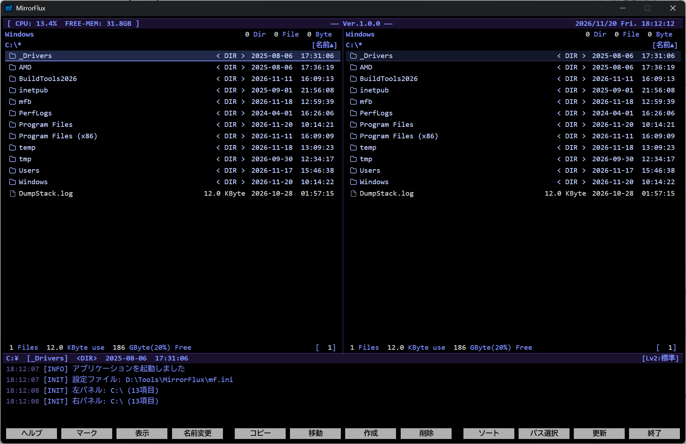

# MirrorFlux (MF)

> **A keyboard-driven dual-pane file manager for Windows**

[日本語](README.md)

MirrorFlux (**MF**) is a dual-pane file manager for Windows that you operate from the keyboard. It handles file operations, browsing and editing inside archives, viewing text, images, PDF and video, and playing video game music, all in one application.



The user interface and the bundled documentation are in Japanese.

## Features

- **Keyboard first**: everything works from the cursor keys, Tab, F1–F12 and single-letter keys. Every key binding can be changed in `mf.ini`.
- **Archives as folders**: open ZIP, LZH/LHA, 7Z, RAR, TAR, GZ and more like ordinary folders. ZIP, LZH/LHA, 7Z and TAR also support adding and deleting files, creating folders inside them, and creating new archives from marked items. No separate 7-Zip installation is needed.
- **Safe file operations**: copy, move and delete ask for confirmation first. When a file with the same name exists, it compares size, date and content, and lets you overwrite, update, rename, auto-number or skip. Copies are completed in a temporary file before replacing the target, so a failure never damages the original.
- **Operation log**: the bottom of the window lists the full path and result of every copied, moved or deleted file, one line each.
- **Viewers**: built-in text viewer (syntax colouring and hex view), image viewer, PDF viewer and video viewer (using Windows' own playback).
- **Video game music player**: plays VGM/VGZ, S98, MDX/PDX, NSF/NSFE, GBS, HES, SPC, KSS, AY, GYM and SAP, as well as ordinary audio files. Chiptunes show each part on a keyboard, level meters and a spectrum, and playback can continue in the sound bar beside the file list.
- **NanoDrive 6 / 7 / 8 hardware output**: send the sound chips of VGM, VGZ and S98 files to NanoDrive and hear them on real chips (ND6: SN76489, YM2612; ND7: YM2413, YM2203, YM3812, YM3526, YMF262, AY-3-8910; ND8: YM2151, OKIM6258). The ND8 also plays MDX (FM and the PDX PCM). All three can be used at once.
- **Portable**: `mf.exe` is a single file that includes the .NET runtime, so no installation is needed. Settings are stored in `mf.ini` next to the EXE; the registry is not used.

## Requirements

- Windows 10 / Windows 11 (x64)

## Getting started

1. Extract `MirrorFlux_win-x64_Portable.zip` to any folder.
2. Run `mf.exe`. It reads the initial settings from `mf.ini` in the same folder.
3. Press `F1` for the list of keys.

## Basic keys (file list)

| Key | Action |
| :--- | :--- |
| `↑` / `↓` | Move the cursor |
| `←` / `→` / `Tab` | Switch between the left and right panes |
| `Enter` | Open a folder or archive / open a file according to its extension setting |
| `Shift+Enter` | Open with the Shift extension setting (or the Windows file association if none) |
| `Backspace` | Go to the parent folder (also leaves an archive) |
| `Space` / `F2` | Mark / unmark |
| `A` / `Shift+A` | Mark all / clear marks |
| `Ctrl+A` | Create an archive from the marked items |
| `C` / `Shift+C` / `F5` | Copy to the other pane (`C` asks first) |
| `M` / `Shift+M` / `F6` | Move to the other pane (`M` asks first) |
| `D` / `Delete` / `F8` | Delete (to the Recycle Bin; inside an archive, removes the entry) |
| `Esc` | Cancel the running copy, move, delete and so on (asks first) |
| `K` / `F7` | Create a folder |
| `R` / `F4` | Change name, attributes and modified date |
| `V` / `Shift+V` / `F3` | Text viewer / hex viewer |
| `G` | Image viewer |
| `I` | Filter by name |
| `J` / `Shift+J` / `F10` | Go to a typed path / jump to a saved path |
| `L` | Choose a drive |
| `-` | Show the same folder in the other pane |
| `S` / `F9` | Change the sort order |
| `F11` | Reload |
| `F12` / `Ctrl+Q` | Quit |

While a copy, move, delete or extraction runs, a progress area appears between the file lists and the status line. It shows the counts, sizes and time left, the file being processed and the next files. Another operation started meanwhile waits its turn and runs afterwards.

Inside each viewer and the music player, `F1` shows its own list of keys.

## Settings

Settings live in `mf.ini` next to `mf.exe`. Edit it with a text editor and restart the application. Every setting and its default is listed, with comments, in [mf.default.ini](mf.default.ini).

- **Key bindings**: change the `>KEY_...` lines. `----` is no modifier, `-s--` Shift, `--a-` Alt, `---c` Ctrl, and `&none;` disables the key.
  ```ini
  >KEY_F2  ---- &filerename;
  >KEY_F12 ---- &none;
  ```
  Viewer keys are set in the `[keys.text]`, `[keys.hex]`, `[keys.graphic]`, `[keys.pdf]`, `[keys.music]` and `[keys.video]` sections.
- **Launching external applications from a key**: in the file list, a key can run a program with arguments instead of a built-in `&...;` command.
  ```ini
  >KEY_E -s-- C:\Tools\viewer.exe %markfiles;
  >KEY_F3 -s-- "C:\Program Files\Editor\editor.exe" --new-window %markfiles;
  ```
  The first line means "`Shift+E` runs `C:\Tools\viewer.exe` with the marked files".
  - `%markfiles` is replaced by the full paths of the marked files in the active pane, each passed as a separate argument. Folders are not included. With nothing marked, the program starts with no files.
  - The trailing `;` marks the end of the line.
  - Quote paths and arguments that contain spaces. Fixed arguments such as `--new-window` can be added.
  - A relative program path is resolved from the folder of `mf.exe`; a bare name is looked up on the Windows search path.
  - Files inside an archive are passed as temporary extracted copies. Saving them in the external program does not update the archive.

  See the [file list documentation](docs/file-list.md) (Japanese) for details.
- **Opening by extension**: lines such as `.txt ---- &textviewer;` choose the viewer for each extension and modifier.
- **Colours**: the `%theme_...` lines change each screen colour.

## ROMs for music playback

Some sound chips need data from the chip's ROM to play every sound. No ROMs are included. Where one is needed, place your own copy:

- **YM2608 (OPNA) rhythm sounds**: put `YM2608_ADPCM.ROM` (8192 bytes) next to `mf.exe` or in its `roms` folder. Without it, everything except the six rhythm sounds still plays.
- **YMF278B (OPL4) PCM**: some songs need `yrw801.rom`. Put it in the song's folder, next to `mf.exe`, or in a `roms` folder beside `mf.exe`. If a needed ROM is missing, you are told when playback starts. Songs that use only FM play without it.

See [external data](docs/external-data.txt) for details.

## Playing on NanoDrive

1. Connect NanoDrive 6 / 7 / 8 to the PC by USB. Each NanoDrive appears as its own COM port.
2. In the `[GME]` section of `mf.ini`, set the NanoDrives you use to `true`, then restart MirrorFlux.
   ```ini
   [GME]
   %ND6-NDSIF  true
   %ND7-NDSIF  false
   %ND8-NDSIF  true
   ```
3. When a VGM, VGZ or S98 file (or MDX, on the ND8) plays, MirrorFlux finds the NanoDrives automatically and plays each supported chip on its NanoDrive. Chips sent to a NanoDrive are not played on the PC. The sound viewer's `EXT DEVICE:` line shows the NanoDrives in use (for example `ND6 ND8`).

- Chips or clocks a NanoDrive does not support are played on the PC.
- Unplugging a NanoDrive during playback does not close the application; NanoDrives are searched again from the next track.
- Even with no audio output device in Windows, a song plays on the NanoDrives alone if at least one of its chips can be sent to a NanoDrive.

See the [music player documentation](docs/music-player.md) (Japanese) for details.

## Building from source

Requires the .NET 10 SDK. Run the following in the repository root; `publish\` will contain `win-x64\mf.exe` and the portable ZIP.

```cmd
build.bat
```

Run the regression tests with:

```powershell
dotnet run --project tests/MirrorFlux.Regression.csproj
```

The tests create their files in a temporary folder and delete them afterwards.

## Disclaimer

- MirrorFlux is provided without any warranty. The author has no obligation to respond to requests, questions or bug reports.
- The author is not liable for any damage or loss arising from using, or being unable to use, MirrorFlux (including lost data or hardware trouble). File operations and NanoDrive playback are at your own risk.

## License

MirrorFlux is released under **GPL-3.0-or-later**. See [LICENSE](LICENSE) and [COPYRIGHT.txt](COPYRIGHT.txt). Bundled third-party components keep their own licenses; see [THIRD_PARTY_NOTICES.md](THIRD_PARTY_NOTICES.md) and `licenses/`.
