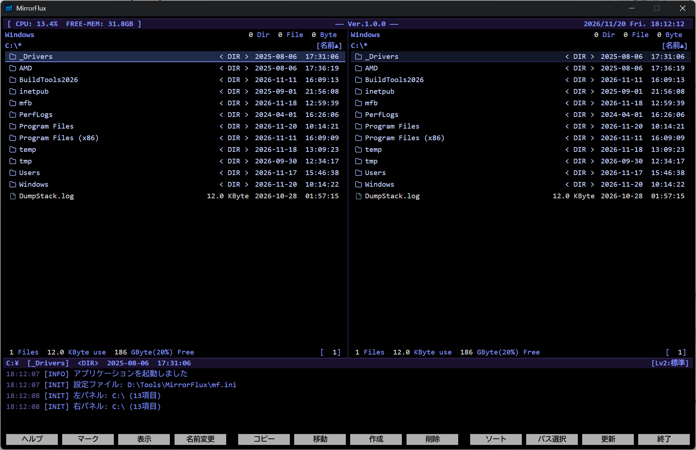

# MirrorFlux (MF)

> **キーボードで操作する Windows 向け2画面ファイラー**

[English](README.en.md)

MirrorFlux（ミラー・フラックス、略称 **MF**）は、キーボードだけで素早く操作できる Windows 向けの2画面ファイラーです。ファイル操作・アーカイブの中身の閲覧と編集・テキスト／画像／PDF／動画の表示・ゲーム音楽の再生までを1つのアプリで行えます。



## 特長

- **キーボード中心の操作**: カーソルキー・Tab・F1〜F12・単体キーだけで操作できます。キーの割り当ては `mf.ini` で変更できます。
- **アーカイブをフォルダーのように扱う**: ZIP・LZH/LHA・7Z・RAR・TAR・GZ などの中を通常のフォルダーと同じように開けます。ZIP・LZH/LHA・7Z・TAR は中へのファイル追加・削除・フォルダー作成、マークした項目からの新規作成にも対応します。7-Zip などを別に入れる必要はありません。
- **安全なファイル操作**: コピー・移動・削除の前に確認し、同名ファイルはサイズ・日時・内容を比べたうえで、上書き・更新・別名・自動連番・スキップを選べます。コピーは一時ファイルで完成させてから置き換えるため、途中で失敗しても元のファイルを壊しません。
- **操作ログ**: 画面下部に、コピー・移動・削除した各ファイルのフルパスと結果を1行ずつ表示します。
- **ビューア**: テキスト（構文の色分け・HEX表示）、画像、PDF、動画（Windows の再生機能を使用）を内蔵しています。
- **ゲーム音楽プレイヤー**: VGM/VGZ・S98・MDX/PDX・NSF/NSFE・GBS・HES・SPC・KSS・AY・GYM・SAP と一般の音声ファイルを再生します。チップチューンは鍵盤・レベルメーター・スペクトラムで各パートの動きを表示し、ファイラーの隅のサウンドバーでも再生を続けられます。
- **NanoDrive 6 / 7 / 8 への実機出力**: VGM・VGZ・S98 の音源チップを NanoDrive に送って、実際のチップで鳴らせます（ND6: SN76489・YM2612、ND7: YM2413・YM2203・YM3812・YM3526・YMF262・AY-3-8910、ND8: YM2151・OKIM6258）。ND8 では MDX（FM と PDX の PCM）も鳴らせます。3台を同時に使えます。
- **ポータブル**: `mf.exe` 1つに .NET ランタイムを含めているので、インストールは不要です。設定は EXE と同じフォルダーの `mf.ini` に保存し、レジストリは使いません。

## 動作環境

- Windows 10 / Windows 11（x64）

## 使い方

1. 配布用の `MirrorFlux_win-x64_Portable.zip` を好きなフォルダーに展開します。
2. `mf.exe` を起動します。初回は同じフォルダーの `mf.ini`（初期設定）を読み込みます。
3. `F1` でキー操作の一覧を表示できます。

## 基本のキー操作（ファイル一覧）

| キー | 動作 |
| :--- | :--- |
| `↑` / `↓` | カーソル移動 |
| `←` / `→` / `Tab` | 左右のパネルを切り替え |
| `Enter` | フォルダー・アーカイブを開く／ファイルを拡張子の設定で開く |
| `Shift+Enter` | Shift 用の拡張子設定で開く（設定がなければ Windows の関連付けで開く） |
| `Backspace` | 親フォルダーへ移動（アーカイブの中から外へも戻れます） |
| `Space` / `F2` | マークを付ける／外す |
| `A` / `Shift+A` | すべてマーク／マーク解除 |
| `Ctrl+A` | マークした項目からアーカイブを作成 |
| `C` / `Shift+C` / `F5` | 反対側のパネルへコピー（`C` は確認あり） |
| `M` / `Shift+M` / `F6` | 反対側のパネルへ移動（`M` は確認あり） |
| `D` / `Delete` / `F8` | 削除（ごみ箱へ。アーカイブの中では項目を削除） |
| `Esc` | 実行中のコピー・移動・削除などを中止（確認あり） |
| `K` / `F7` | フォルダーを作成 |
| `R` / `F4` | 名前・属性・更新日時の変更 |
| `V` / `Shift+V` / `F3` | テキストビューア／HEX ビューア |
| `G` | 画像ビューア |
| `I` | 名前で絞り込み |
| `J` / `Shift+J` / `F10` | パスを入力して移動／登録したパスへジャンプ |
| `L` | ドライブの選択 |
| `-` | 反対側のパネルを同じフォルダーにする |
| `S` / `F9` | 並び順の変更 |
| `F11` | 再読み込み |
| `F12` / `Ctrl+Q` | 終了 |

コピー・移動・削除・展開の実行中は、ファイル一覧とステータス行の間に進行欄が出ます。件数・量・残り時間、いま処理しているファイル、次のファイルが見えます。実行中に始めた別の操作は順番待ちになり、終わると順に実行します。

ビューアや音楽プレイヤーの中では、それぞれの `F1` で操作の一覧を表示します。

## 設定

設定は `mf.exe` と同じフォルダーの `mf.ini` にあります。テキストエディターで編集し、アプリを再起動すると反映されます。初期値の全項目は [mf.default.ini](mf.default.ini) にコメント付きで載っています。

- **キーの割り当て**: `>KEY_...` の行で変更します。`----` は修飾キーなし、`-s--` は Shift、`--a-` は Alt、`---c` は Ctrl、`&none;` は無効です。
  ```ini
  >KEY_F2  ---- &filerename;
  >KEY_F12 ---- &none;
  ```
  ビューアごとのキーは `[keys.text]`・`[keys.hex]`・`[keys.graphic]`・`[keys.pdf]`・`[keys.music]`・`[keys.video]` の各セクションで設定します。
- **キーから外部アプリを起動**: ファイル一覧のキーには、`&...;` の内蔵機能の代わりに実行ファイルと引数を書けます。
  ```ini
  >KEY_E -s-- C:\Tools\viewer.exe %markfiles;
  >KEY_F3 -s-- "C:\Program Files\Editor\editor.exe" --new-window %markfiles;
  ```
  1行目は「`Shift+E` で `C:\Tools\viewer.exe` を起動し、マークしたファイルを渡す」という意味です。
  - `%markfiles` は、操作中のパネルでマークしたファイルのフルパスに置き換わり、1件ずつ別の引数として渡されます。フォルダーは含みません。マークがなければ何も渡さずに起動します。
  - 行末の `;` は行の終わりの印です。
  - 空白を含むパスや引数は `"` で囲みます。`--new-window` のような固定の引数も書けます。
  - 実行ファイルを相対パスで書くと `mf.exe` のフォルダーが基準になり、名前だけなら Windows の検索パスから探します。
  - アーカイブの中のファイルは一時フォルダーへ取り出したものを渡します。外部アプリで保存しても、アーカイブには反映されません。

  詳しくは [ファイル一覧の資料](docs/file-list.md#キーから外部アプリを起動する) を参照してください。
- **拡張子ごとの開き方**: `.txt ---- &textviewer;` のように、拡張子と修飾キーごとに開くビューアを決められます。
- **色**: `%theme_...` の行で画面の各色を変更できます。

## 音楽再生用の ROM

一部の音源チップは、チップの ROM のデータがあると音を全部鳴らせます。ROM はアプリに含めていません。必要な場合は、ご自身で用意したものを置いてください。

- **YM2608（OPNA）のリズム音**: `YM2608_ADPCM.ROM`（8192 バイト）を `mf.exe` と同じフォルダーか、その下の `roms` フォルダーに置きます。ROM がなくても、リズムの6音以外は鳴ります。
- **YMF278B（OPL4）の PCM**: 曲によっては `yrw801.rom` が必要です。曲と同じフォルダー、`mf.exe` と同じフォルダー、またはその下の `roms` フォルダーに置きます。必要な ROM がないときは、再生を始めるときにお知らせします。FM だけの曲は ROM なしで鳴ります。

詳しくは [外部データの案内](docs/external-data.txt) を参照してください。

## NanoDrive で鳴らす

1. NanoDrive 6 / 7 / 8 を USB で PC につなぎます。それぞれ別々の COM ポートとして認識されます。
2. `mf.ini` の `[GME]` セクションで、使う NanoDrive を `true` にして、MirrorFlux を再起動します。
   ```ini
   [GME]
   %ND6-NDSIF  true
   %ND7-NDSIF  false
   %ND8-NDSIF  true
   ```
3. VGM・VGZ・S98（ND8 では MDX も）を再生すると、NanoDrive を自動で探し、対応する音源チップをその NanoDrive で鳴らします。NanoDrive に送ったチップはPCでは鳴らしません。サウンドビューアの `EXT DEVICE:` に、使っている NanoDrive（例 `ND6 ND8`）が表示されます。

- NanoDrive が対応していないチップやクロックの音源は、PCで鳴らします。
- 再生中に NanoDrive を外してもアプリは終了せず、次の曲から探し直します。
- Windows に音声出力デバイスがなくても、曲の音源のどれかを NanoDrive に送れる場合は、NanoDrive だけで再生します。

詳しくは [音楽プレイヤーの資料](docs/music-player.md#nanodrivendsifへの実機出力) を参照してください。

## 資料

- [ファイル一覧](docs/file-list.md)・[ジャンプリスト](docs/jump-list.md)
- [アーカイブ](docs/archive.md)
- [テキストビューア](docs/text-viewer.md)・[画像ビューア](docs/graphic-viewer.md)・[動画ビューア](docs/video-viewer.md)
- [音楽プレイヤー](docs/music-player.md)・[VGM の対応状況](docs/vgm-compatibility.md)・[レベルメーター](docs/level-meter.md)
- [外部データ（ROM）の案内](docs/external-data.txt)

## ソースからのビルド

.NET 10 SDK が必要です。リポジトリの直下で次を実行すると、`publish\` に `win-x64\mf.exe` と配布用 ZIP が作られます。

```cmd
build.bat
```

回帰テストは次のコマンドで実行します。テスト用のファイルは一時フォルダーに作り、終了時に削除します。

```powershell
dotnet run --project tests/MirrorFlux.Regression.csproj
```

テストの種類と実行方法は `tests/Program.cs` の各オプションを参照してください。

## 免責事項

- MirrorFlux は無保証で提供しています。作者は、要望・質問・不具合報告に対応する義務を負いません。
- MirrorFlux を使ったこと、または使えなかったことによって生じたいかなる損害・不利益（データの消失や機器の不調を含みます）についても、作者は責任を負いません。ファイル操作や NanoDrive での再生は、ご自身の判断と責任で行ってください。

## ライセンス

MirrorFlux は **GPL-3.0-or-later** で公開しています。[LICENSE](LICENSE) と [著作権と適用範囲](COPYRIGHT.txt) を参照してください。同梱している第三者の部品は、それぞれ元のライセンスに従います。一覧は [第三者通知](THIRD_PARTY_NOTICES.md) と `licenses/` にあります。

## 謝辞

MirrorFlux の制作は mint、mmdsp、fmdsp、hoot、vgmplay などから多大な影響を受けており、これらを生み育ててきた皆さまに深い敬意と感謝を表します。
